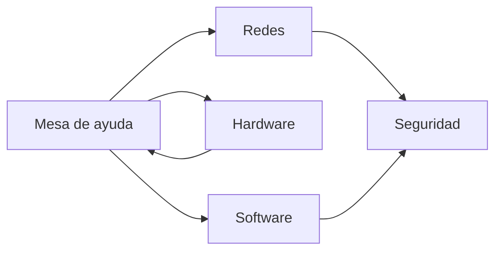
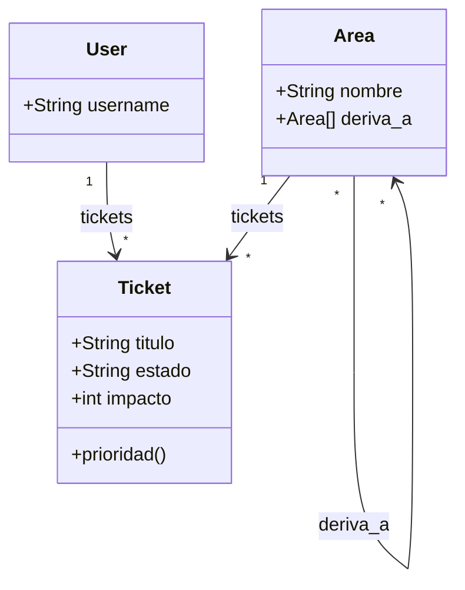

# Sistema de Gestión de Tickets de Soporte

Proyecto de portafolio del curso **Estructura de Datos y Algoritmos** (semanas 8 a 15).

## Semana 11 — Índice BST de tickets, db_index y lista paginada

- `tickets/estructuras/arbol_bst.py` contiene `NodoBST`, `insertar`,
  `buscar_con_pasos`, `altura` y la función propia `construir_indice`. Esta
  recibe los tickets, forma parejas `(id, titulo)` y las inserta en un árbol
  binario de búsqueda; si `mezclar=True`, primero usa `random.shuffle`.
- Sin mezclar, los ids llegan en orden y el árbol queda degenerado: con 12
  tickets su altura es 12. Al mezclar, la altura baja porque las ramas se
  reparten.
- `CodigoPrueba` tiene dos columnas con los mismos números: `sin_indice` y
  `con_indice` (`db_index=True`). La migración `0004_codigoprueba` está aplicada.
- `tickets/estructuras/medir.py` carga 100 000 filas y compara el plan de
  SQLite al buscar el mismo código en ambas columnas.
- `TicketListView` usa `LoginRequiredMixin`, `ListView`, `paginate_by = 5` y
  ordena por `-creado`. La ruta es `/tickets/todos/` y la plantilla es
  `tickets/todos.html`.

### Evidencias de la Semana 11

En `evidencias/`:

- `08_indice_bst.png` — altura con y sin mezcla, y pasos para encontrar un ticket.
- `09_migracion_codigoprueba.png` — migración `0004` aplicada, sin cambios pendientes.
- `10_medir_indices.png` — `SCAN` sin índice y `SEARCH ... USING INDEX` con índice.
- `11_lista_pagina1.png` — primera página de cinco tickets.
- `12_lista_pagina2.png` — segunda página, con los enlaces Anterior y Siguiente.

### Preguntas de la guía de la Semana 11

**a) ¿Por qué su índice quedó con una altura igual a la cantidad de tickets cuando no los mezclaron?**

R: Porque los tickets salieron ordenados por id y cada id nuevo era mayor que
el anterior, así que siempre se insertó por la derecha. Cada nodo quedó con un
solo hijo y el árbol terminó siendo una fila: con 12 tickets, la altura fue 12.
Al mezclar, los ids llegaron en desorden, las ramas se repartieron y la altura
bajó.

**b) En la salida de explain(), ¿qué significa SCAN y qué significa SEARCH USING INDEX?**

R: `SCAN` significa que SQLite recorrió toda la tabla fila por fila porque la
columna sin índice no tiene una estructura que le permita descartar valores.
`SEARCH ... USING INDEX` significa que usó el índice de `con_indice` para bajar
por el árbol B y encontrar el valor sin revisar las 100 000 filas.

### Commit de la Semana 11

Enlace del commit: https://github.com/NicolasPumaLuicho/soporte-tickets-django/commit/e317940b4ce25c779a022bbcdfa5eb781601fa68

Repositorio: https://github.com/NicolasPumaLuicho/soporte-tickets-django

---

## Semana 10 — Prioridad del ticket con un árbol de expresión e inicio de sesión

- `Categoria` tiene el campo `peso` (1 normal, 3 crítica) y `Ticket` tiene
  `creado`, `impacto`, `categoria` y `creado_por`. Migración `0003` aplicada.
- `tickets/estructuras/arbol_expresion.py` contiene `NodoExpresion`,
  `construir_postfija` y `evaluar_con_variables`. La fórmula se guarda en
  postfija (`"impacto peso * dias +"`) y el árbol la calcula con el diccionario
  de valores; no se usa `eval()`.
- `Ticket.prioridad()` arma el árbol con `FORMULA_PRIORIDAD` y lo evalúa con
  `evaluar_con_variables(arbol, valores)`.
- Inicio y cierre de sesión con `django.contrib.auth` en `/cuentas/` y la
  plantilla `registration/login.html`.
- Grupos `Cliente` y `Agente`. El agente ve los tickets abiertos urgentes
  (filtro `Q(estado="abierto") & (Q(impacto=3) | Q(categoria__peso__gte=3))`)
  ordenados por prioridad; el cliente solo ve los tickets que creó.
- `@login_required` manda al login a quien no inició sesión.

### Cómo ejecutar

```bash
pip install django
python manage.py migrate
python manage.py cargar_datos_s08        # ticket de prueba con 5 comentarios
python manage.py cargar_categorias_s09   # categorías de ejemplo (3 niveles)
python manage.py cargar_datos_s10        # categorías con peso, usuarios y tickets de prueba
python manage.py runserver
```

- Lista de tickets: http://127.0.0.1:8000/
- Detalle del ticket: http://127.0.0.1:8000/ticket/1/
- Login: http://127.0.0.1:8000/cuentas/login/
- Admin: http://127.0.0.1:8000/admin/ (usuario `admin` / contraseña `admin123`, solo para desarrollo local)
- Usuarios de prueba: `nicolas` (Cliente), `carla` (Cliente), `agente` (Agente).
  Contraseñas de desarrollo: `cliente2026` y `agente2026`.

### Evidencias de la Semana 10

En `evidencias/`:

- `01_login.png` — formulario de ingreso en `/cuentas/login/`.
- `03_lista_cliente.png` — el cliente `nicolas` ve solo sus tickets.
- `04_lista_agente.png` — el agente ve los tickets urgentes ordenados por prioridad.
- `05_shell_prioridades.png` — `prioridad()` ejecutado en `python manage.py shell`.
- `06_migracion.png` — migración `0003` aplicada y sin cambios pendientes.

### Preguntas de la guía de la Semana 10

**a) En el filtro con `Q()` del paso 2, ¿cuáles son las hojas y cuáles los nodos internos?**

R: Las hojas son cada condición: `Q(estado="abierto")`, `Q(impacto=3)` y
`Q(categoria__peso__gte=3)`. Los nodos internos son los conectores: el `OR`
une las dos últimas condiciones y el `AND` es la raíz que une `estado="abierto"`
con ese `OR`.

**b) ¿Por qué conviene guardar la fórmula de prioridad en postfija y no en infija?**

R: Porque en postfija no hacen falta paréntesis ni reglas de precedencia: el
árbol se arma con una pila leyendo los tokens en orden, y cada operador toma
los dos últimos operandos. Además, si cambia la regla de negocio solo se
modifica el texto de la fórmula, sin tocar el código que la evalúa.

### Commit de la Semana 10

Enlace del commit: https://github.com/NicolasPumaLuicho/soporte-tickets-django/commit/72800def90a6aabe5b0aa041647f2f14d4772cc4

Repositorio: https://github.com/NicolasPumaLuicho/soporte-tickets-django

---

## Semana 9 — Menú de categorías con un árbol genérico

- Modelo `Categoria` con un campo `padre` que apunta a la misma tabla (`"self"`).
  Una categoría sin padre es de primer nivel y sus hijas se consultan con
  `subcategorias`.
- Migración `0002_categoria` aplicada y `Categoria` registrada en el Django Admin.
- `tickets/estructuras/arbol_categorias.py` contiene `NodoGenerico`, `mostrar` y
  `construir_arbol`. Esta última arma el árbol con un diccionario `id → nodo`,
  sin librerías externas.
- `tickets/context_processors.py` entrega el árbol a todas las plantillas como
  `menu_categorias`.
- `tickets/templatetags/menu_tags.py` define la etiqueta recursiva `nodo_menu`,
  que usa `tickets/_nodo_menu.html`. El menú completo se incluye en `base.html`
  con ``.
- El menú se muestra en la lista de tickets y en el detalle de cada ticket.
  Al agregar una categoría desde el admin, aparece al recargar sin modificar
  ninguna plantilla.

### Cómo ejecutar

```bash
pip install django
python manage.py migrate
python manage.py cargar_datos_s08        # ticket de prueba con 5 comentarios
python manage.py cargar_categorias_s09   # categorías de ejemplo (3 niveles)
python manage.py runserver
```

- Lista de tickets: http://127.0.0.1:8000/
- Detalle del ticket: http://127.0.0.1:8000/ticket/1/
- Admin: http://127.0.0.1:8000/admin/ (usuario `admin` / contraseña `admin123`, solo para desarrollo local)

### Evidencias de la Semana 9

En `evidencias/`:

- `01_menu_inicio.png` — menú con las categorías de tres niveles antes de agregar la nueva.
- `02_admin_categorias.png` — admin con las 12 categorías y su categoría padre.
- `03_admin_nueva_categoria.png` — alta de «WiFi invitados» con padre «WiFi».
- `04_admin_categoria_guardada.png` — confirmación del alta y la nueva fila en el admin.
- `05_menu_con_nueva_categoria.png` — el menú recargado ya muestra «WiFi invitados».
- `06_menu_detalle_ticket.png` — el mismo menú en el detalle del ticket.
- `07_shell_arbol.png` — `construir_arbol` y `mostrar` ejecutados en `python manage.py shell`.

### Preguntas de la guía de la Semana 9

**a) ¿Qué recorrido del laboratorio sigue el template tag recursivo y por qué?**

R: Sigue un recorrido preorden: dibuja el nodo (el padre) y después se llama a
sí mismo por cada hijo, de izquierda a derecha. Es el mismo orden de `mostrar`
del laboratorio y así el `<ul>` anidado refleja la profundidad; el caso base es
un nodo sin hijos.

**b) ¿Qué pasaría con el menú si una categoría tuviera como padre a una de sus propias subcategorías?**

R: Se formaría un ciclo y esa rama nunca tendría un camino hasta la raíz
«Categorías», por lo que `construir_arbol` no la colgaría de la raíz y el menú
no la mostraría. Si se intentara dibujar el ciclo directamente, la etiqueta se
llamaría a sí misma sin parar; por eso hay que evitar que un padre sea
descendiente de la propia categoría.

### Commit de la Semana 9

Enlace del commit: https://github.com/NIckKIng6969/soporte-tickets-django/commit/53f38ec15d35c71909c65532af6b72c8cede5214

Repositorio: https://github.com/NIckKIng6969/soporte-tickets-django

---

## Semana 8 — Historial de comentarios con lista doblemente enlazada

- Modelo `Comentario` con `ForeignKey` a `Ticket` (`related_name="comentarios"`),
  texto, autor y fecha de creación.
- Migración aplicada y `Comentario` registrado en el Django Admin.
- Clase `HistorialComentarios` (lista doblemente enlazada propia, sin librerías
  externas) en `tickets/historial.py`, con `actual()`, `anterior()` y `siguiente()`.
- Vista de detalle del ticket que muestra **un comentario a la vez** con los
  botones «Anterior» y «Siguiente».

### Preguntas de la guía de la Semana 8

**a) ¿Qué equivale, en su lista doble, a `has_previous()` y a `has_next()` del Paginator?**

R: Equivalen a comprobar si el puntero actual tiene nodo anterior o siguiente.
En la lista, `has_previous()` es `historial.actual.anterior is not None` y
`has_next()` es `historial.actual.siguiente is not None`; es decir, devolver
`False` cuando el puntero ya está en la cabeza o en la cola. En la vista, esas
comprobaciones son las que deciden si el botón «Anterior» o «Siguiente» se
muestra habilitado o deshabilitado.

**b) Si llega un comentario nuevo mientras el agente lee el comentario 3, ¿qué método de su lista doble usarían para agregarlo al final sin perder la posición actual?**

R: El método que inserta al final de la lista (`agregar_al_final()`). Como
conserva los enlaces de todos los nodos y solo engancha el nodo nuevo después
de la cola, el puntero actual se queda donde estaba: el agente sigue leyendo
el comentario 3 y el comentario nuevo queda disponible al final del historial.

## Semana 12 — Índice balanceado y pruebas unitarias

- `tickets/estructuras/arbol_bst.py` ahora tiene también `a_lista`,
  `construir_balanceado`, `construir_indice_balanceado` y `contar_pasos`.
  `construir_indice_balanceado` forma las parejas `(id, titulo)`, las ordena
  con `sort()` y arma el árbol tomando como raíz el elemento del medio.
  `contar_pasos` hace lo mismo que `buscar_con_pasos`, pero sin imprimir nada.
- Comparación en el shell con los 12 tickets de la base: sin mezclar el árbol
  queda en fila (12 niveles y 12 pasos para llegar al último ticket);
  balanceado baja a 4 niveles y 3 pasos.
- `tickets/tests.py` tiene las 4 pruebas de la guía y la clase `BusquedaTest`
  con `test_busqueda_rapida`. `python manage.py test tickets` termina en `OK`
  con 5 pruebas.
- Si se cambia `medio = len(datos) // 2` por `medio = 0` fallan 2 pruebas (la
  de la altura y la de la búsqueda); al devolver la línea, vuelven a pasar.

### Evidencias de la Semana 12

En `evidencias/`:

- `13_shell_indice_balanceado.png` — los dos índices comparados en el shell.
- `14_pruebas_ok.png` — `manage.py test tickets` con las 5 pruebas en OK.
- `15_pruebas_fail.png` — el FAIL provocado con `medio = 0`.

### Preguntas de la guía de la Semana 12

**a) ¿Por qué con medio = 0 falló la prueba de la altura?**

R: Porque con `medio = 0` la función siempre agarra `datos[0]` como raíz, que
es el id más chico. Todos los demás elementos van a `datos[1:]`, o sea, al lado
derecho, y en cada llamada pasa lo mismo. El árbol termina siendo una fila de
100 nodos y su altura es 100, cuando la prueba pide 7 como máximo. La prueba
de la búsqueda también falla por lo mismo: encontrar el ticket 100 revisa los
100 nodos.

**b) ¿Para qué sirve tener pruebas unitarias si el programa ya funciona hoy?**

R: Sirven para darse cuenta al instante si algo se rompe cuando alguien cambia
el código. Si no hubiera pruebas, el error de `medio = 0` pasaría paseando: la
página seguiría cargando, pero el índice volvería a ser una fila y las
búsquedas serían lentas. Con las pruebas, un solo comando revisa en segundos
que la altura, el orden y la búsqueda sigan bien, sin tener que abrir el
navegador y probar a mano.

## Semana 13 — Cola de prioridad con heap y API de urgentes

- `tickets/estructuras/cola_prioridad.py` contiene `MinHeap`, `cola_urgentes` y
  `primeros`. Cada ticket abierto se guarda como `(-prioridad, id, titulo)` para
  que el de mayor prioridad salga primero y, si hay empate, gane el id más bajo.
- `tickets/api.py` define `UrgentesAPI`. La ruta `/api/tickets/urgentes/?n=3`
  devuelve los tres tickets abiertos más urgentes en JSON y exige iniciar sesión.
- Sin sesión, la API responde 403 y exige credenciales de autenticación.
- `tickets/tests.py` suma cuatro pruebas de la cola y una de acceso a la API.
  `python manage.py test tickets` ejecuta 10 pruebas y termina en `OK`.

### Evidencias de la Semana 13

En `evidencias/`:

- `16_shell_cola_prioridad.png` — prueba de la cola en el shell de Django.
- `17_api_urgentes.png` — respuesta JSON con el usuario agente autenticado.
- `18_api_403.png` — respuesta 403 al consultar sin iniciar sesión.
- `19_pruebas_ok.png` — las 10 pruebas terminando en `OK`.

### Preguntas de la guía de la Semana 13

**a) ¿Por qué guardan -prioridad, y no prioridad, en un min-heap?**

R: Porque el min-heap pone arriba el número más chico. Al guardar la prioridad
10 como -10, esa queda por debajo de -4 o -1 y sale primero. Así atendemos de
mayor a menor prioridad sin cambiar el funcionamiento del min-heap.

**b) ¿Qué diferencia hay entre la página de lista de tickets y la API de urgentes?**

R: La lista muestra una página HTML para que la vea una persona y tiene sus
enlaces y botones. La API no muestra esa página: devuelve solamente los tickets
urgentes en JSON, ya ordenados por el heap, para que los use otro programa.

## Semana 15 — Red de derivación entre áreas

- Modelo `Area` con `nombre` único y `deriva_a`, un
  `ManyToManyField("self", symmetrical=False, related_name="recibe_de")`.
  Migración `0005_area_ticket_area` aplicada.
- `Ticket.area` es una `ForeignKey` a `Area` con `SET_NULL`: si se borra un
  área, sus tickets quedan sin área pero no se pierden.
- `Area` está registrada en el admin con `filter_horizontal = ("deriva_a",)`.
- `tickets/estructuras/grafo.py` tiene la clase `Grafo` del laboratorio 15
  (matriz de adyacencia con `vecinos`, `grado` y `grado_entrada`).
- `tickets/estructuras/red.py` define `red_de_areas(areas)`: crea un `Grafo`
  dirigido con los nombres de las áreas y, por cada área, agrega una arista
  hacia cada destino de `area.deriva_a.all()`.
- La vista `red_areas` (con `@login_required`) está en `/areas/red/` y muestra
  la matriz junto con las columnas Salen y Llegan.

### Red de derivación entre áreas



Mesa de ayuda deriva a Redes, Hardware y Software, y Hardware devuelve la
derivación a Mesa de ayuda. Redes y Software solo derivan a Seguridad, que es
el área que no deriva a nadie.

### Modelos del proyecto



### Evidencias de la Semana 15

En `evidencias/`:

- `20_migracion_area.png` — `makemigrations` crea `0005_area_ticket_area`.
- `21_shell_red_areas.png` — `red_de_areas` y la matriz en `python manage.py shell`.
- `22_red_areas.png` — la página `/areas/red/` con la sesión iniciada.
- `23_pruebas_ok.png` — `manage.py test tickets` con las 12 pruebas en OK.

### Preguntas de la guía de la Semana 15

**a) ¿Por qué `deriva_a` usa `symmetrical=False`? ¿Qué pasaría con la matriz si fuera `True`?**

R: Porque una derivación va en un solo sentido: que Mesa de ayuda derive a
Redes no significa que Redes vuelva a derivar a Mesa de ayuda. Con
`symmetrical=False` la tabla intermedia guarda solo la pareja que se registra y
la matriz queda dirigida, con 1 únicamente en la fila del área que deriva. Si
fuera `True`, Django agregaría también la pareja inversa, la matriz quedaría
simétrica y aparecerían derivaciones que nadie registró en el admin (por
ejemplo, Seguridad aparecería derivando a Redes y a Software).

**b) ¿Qué guarda cada fila de la tabla intermedia que crea el `ManyToManyField`?**

R: Cada fila guarda una pareja (área de origen, área de destino): el id del
área que deriva y el id del área que recibe, en las columnas `from_area_id` y
`to_area_id`. Al recorrer esas filas se arma la matriz: se busca el índice del
origen (fila) y el del destino (columna) y se coloca el 1.

## Recuperación — Semanas 4 a 6 del proyecto de portafolio

- `tickets/estructuras/pila_historial.py` define `PilaEstados` (`apilar`,
  `desapilar`, `cima`, `esta_vacia` y `__len__`). `tickets/estados.py` la usa
  para deshacer: `cambiar_estado()` guarda el estado anterior en la pila del
  ticket y `deshacer_ultimo_cambio()` lo restaura; si no hay cambios previos,
  devuelve `False` y no toca el ticket.
- `tickets/estructuras/cola_tickets.py` define `ColaTickets` (FIFO).
  `tickets/asignacion.py` encola los tickets abiertos ordenados por `creado` e
  `id`, y `asignar_siguiente_ticket()` saca el más antiguo y lo pasa a
  `en_proceso`.
- La ruta `/asignar-siguiente/` (con `@login_required`) usa esa función y avisa
  con `django.contrib.messages`. `base.html` muestra los mensajes dentro del
  `<main>`, por lo que los avisos aparecen en la lista en el mismo orden en que
  se asignaron los tickets.
- `tickets/estructuras/cola_circular.py` define `ColaCircular` para los turnos:
  si está llena rechaza el turno nuevo y, al atender uno, reutiliza esa posición.
- Modelo `Articulo` con `titulo` único y `db_index=True` (migración
  `0006_articulo` aplicada). `python manage.py cargar_articulos_s06` carga los
  6 artículos de prueba.
- `tickets/busqueda.py` define `buscar_articulo()`: una búsqueda binaria manual
  sobre los títulos ordenados que cuenta las comparaciones. Con los 6 artículos
  encuentra «Restablecer VPN» en 2 comparaciones.
- `tickets/tests.py` pasa de 12 a 24 pruebas con `python manage.py test tickets`.

### Commits de la recuperación

- Semana 4 — pila de estados y deshacer el último cambio: https://github.com/NicolasPumaLuicho/soporte-tickets-django/commit/7033f330184e0ab3e85937b1d35ad134e4524645
- Semana 5 — cola FIFO de pendientes, vista de asignación y orden de los mensajes: https://github.com/NicolasPumaLuicho/soporte-tickets-django/commit/e74f392a1fbb308fdf77f44ff2359a430f9bd576
- Semana 6 — cola circular de turnos, catálogo de artículos y búsqueda binaria: https://github.com/NicolasPumaLuicho/soporte-tickets-django/commit/9187de67bf6667c8e997d82883763ef893a5b6bc

Repositorio: https://github.com/NicolasPumaLuicho/soporte-tickets-django

---

## Integrantes

- Nicolás Puma Luicho
- _(compañero/a de equipo — completar)_
